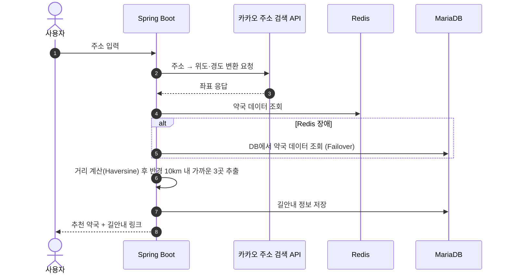
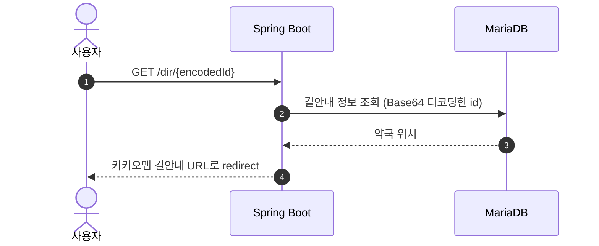

# 💊 약국 추천 서비스 (Pharmacy Recommendation Backend)

사용자가 주소를 입력하면 **가장 가까운 약국 3곳**을 찾아 카카오맵 길안내 링크로 알려주는 Spring Boot 백엔드입니다.
공공데이터(전국 약국 현황)와 카카오 주소 검색 API를 활용합니다.

> ⚠️ **현재 상태: 개발 진행 중 (학습 프로젝트)**
> 설계, 인프라 구성, 데이터 계층과 테스트 환경까지 만들었고, 추천 로직과 캐시·배포는 구현 중입니다.
> 아래 [진행 현황](#진행-현황)에 완료된 부분과 남은 부분을 구분해 두었습니다.

## 프로젝트 개요

| 항목 | 내용 |
| --- | --- |
| 개발 기간 | 2023.05 ~ (진행 중) |
| 인원 | 1명 (개인 프로젝트) |
| 목적 | Spring Boot 기반 API 서버 설계, 외부 API 연동, 테스트 자동화(Spock·Testcontainers), Docker 멀티 컨테이너 구성 학습 |

## 기술 스택

- **Language / Framework**: Java 17, Spring Boot 2.6, Spring Data JPA
- **Database / Cache**: MariaDB 10, Redis 6
- **Test**: Spock 2.1 (Groovy), Testcontainers
- **Infra**: Docker, Docker Compose
- **External API**: 카카오 로컬(주소 검색) API, 카카오맵 길찾기 URL
- **Build**: Gradle
- **View**: Handlebars, Bootstrap (간단한 검색 화면)

## 시스템 흐름

### 약국 추천


### 길안내 단축 URL


원본 설계도(PlantUML)는 `src/main/resources/static/plantUML/`에 있습니다.

## 진행 현황

| 구분 | 내용 | 상태 |
| --- | --- | --- |
| 설계 | 추천·길안내 시퀀스 다이어그램 (PlantUML) | ✅ 완료 |
| 인프라 | App + MariaDB + Redis Docker Compose 구성, 로컬/운영 프로필 분리 | ✅ 완료 |
| 데이터 계층 | `Pharmacy` 엔티티, JPA Repository, 생성·수정 시각 자동 기록(`BaseTimeEntity`) | ✅ 완료 |
| 테스트 환경 | Spock + Testcontainers로 Redis·DB를 띄우는 통합 테스트 베이스 클래스, Repository 테스트 | ✅ 완료 |
| 외부 API | 카카오 주소 검색 API 호출 서비스 (`KakaoAddressSearchService`, `KakaoUriBuilderService`) | 🚧 작성 중 |
| 추천 로직 | Haversine 거리 계산 함수 작성, 가까운 3곳 추출 로직 | 🚧 작성 중 |
| 캐시 | Redis에 약국 데이터 캐싱, 장애 시 DB Failover | ⏳ 예정 |
| 안정성 | Spring Retry로 카카오 API 네트워크 오류 재처리 | ⏳ 예정 |
| 단축 URL | Base64 인코딩으로 길안내 URL 단축 | ⏳ 예정 |
| 배포 | 클라우드 서버에 Docker Compose로 배포 | ⏳ 예정 |

## 구현하면서 고민한 점

### 1. 테스트가 로컬 환경에 의존하지 않게 하기
통합 테스트가 내 PC에 설치된 DB·Redis에 의존하면 다른 환경에서 결과가 달라집니다.
Testcontainers로 테스트를 실행할 때마다 Redis 컨테이너를 새로 띄우고, 그 주소를 Spring 설정에 주입하는
공통 베이스 클래스(`AbstractIntegrationContainerBaseTest`)를 만들어 모든 통합 테스트가 같은 환경에서 돌도록 했습니다.

### 2. 컨테이너 실행 순서 문제
`depends_on`은 컨테이너 **시작 순서**만 보장하고, DB가 실제로 접속 가능한 상태인지는 확인하지 않습니다.
그래서 앱이 DB보다 먼저 준비되어 실패하는 경우가 있어, 앱 컨테이너에 `restart: always`를 두어 DB가 준비될 때까지 재시작하도록 했습니다.

### 3. 비밀 정보 분리
DB 비밀번호와 카카오 API 키는 코드에 넣지 않고 `.env` 파일의 환경 변수로 주입합니다 (`.env`는 `.gitignore`에 포함).

## 실행 방법

### 1. 환경 변수 준비
프로젝트 루트에 `.env` 파일을 만듭니다.
```env
SPRING_PROFILES_ACTIVE=local
SPRING_DATASOURCE_USERNAME=root
SPRING_DATASOURCE_PASSWORD=비밀번호
KAKAO_REST_API_KEY=카카오_REST_API_키
```

### 2. DB·Redis 실행
```bash
docker compose -f docker-compose-local.yml up -d
```

### 3. 애플리케이션 실행
```bash
./gradlew bootRun
```

### 4. 테스트 실행 (Docker 필요)
```bash
./gradlew test
```

## 프로젝트 구조

```
├── Dockerfile                  # 애플리케이션 이미지
├── docker-compose.yml          # App + MariaDB + Redis (운영)
├── docker-compose-local.yml    # MariaDB + Redis (로컬 개발용)
├── database/                   # MariaDB 이미지·설정
├── redis/                      # Redis 이미지
└── src/
    ├── main/java/...           # 애플리케이션 코드
    ├── main/resources/         # 설정, 화면 템플릿, 설계도
    └── test/                   # Spock 테스트
```

> 작성 중인 추천 기능 코드(카카오 API 연동, 거리 계산 등)는 현재 `src/src/` 아래에 있으며, `src/main`으로 합치는 작업이 남아 있습니다.
