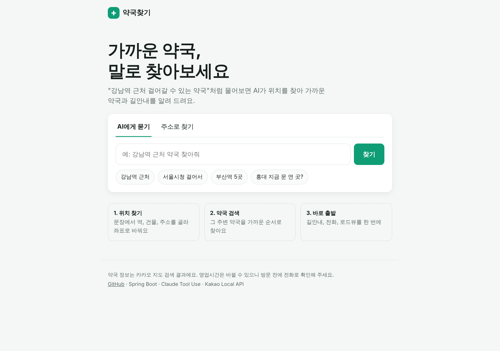
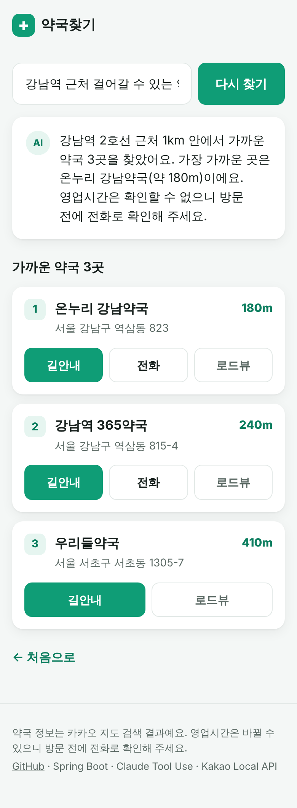

# 약국 추천 서비스 (pharmacy-backend)

주소를 입력하면 **반경 10km 안에서 가장 가까운 약국 3곳**과 카카오맵 길안내·로드뷰 링크를 알려 주는 Spring Boot 서비스입니다.
**"강남역 근처 약국 찾아줘"처럼 문장으로 물어도** Claude 가 Tool Use 로 장소를 찾아 같은 검색을 불러 줍니다.
**"잠실에서 일요일 밤 10시에 여는 약국"**처럼 시간 조건을 붙이면 국립중앙의료원 공공데이터의 요일별 영업시간으로 걸러 줍니다.

**데모:** https://pharmacy-ikyoon.onrender.com
> 무료 서버라서 15분 동안 접속이 없으면 잠듭니다. 첫 접속은 30초~1분쯤 걸릴 수 있어요.

## 화면

| 첫 화면 | AI 검색 결과 (모바일) |
|---|---|
|  |  |

- 탭으로 "AI에게 묻기"와 "주소로 찾기"를 나누고, 예시 질문 칩을 누르면 입력칸이 채워집니다.
- AI 검색은 **SSE(Server-Sent Events)로 실시간**으로 보여 줍니다. "'강남역' 위치를 찾고 있어요 → 일요일 22:00에 여는 약국을 찾고 있어요" 같은 진행 단계가 차례로 뜨고, Claude 답변은 한 글자씩 나옵니다. 버튼은 잠가서 두 번 요청을 막습니다.
- 결과는 카드로 보여 주고, 약국마다 길안내 / 전화 / 로드뷰 버튼을 둡니다. 전화번호는 카카오 검색 결과의 `phone` 값을 씁니다.
- 영업시간 데이터가 있는 약국은 카드에 "영업 중 / 영업 종료"와 오늘 영업시간을 보여 줍니다.

## 화면 흐름

```
주소 입력 ──► POST /search ──► 약국 3곳 표 ──► /dir/{code} ──► 카카오맵 길안내

문장 입력 ──► POST /ai-search ──► Claude ──tool_use──► find_location (카카오 주소/키워드 검색)
                                    │   ──tool_use──► search_pharmacies (카카오 약국 검색 + 저장)
                                    │   ──tool_use──► search_open_pharmacies (요일·시각에 여는 약국, DB 조회)
                                    └──► 짧은 안내 문장 + 약국 표 (표는 도구 결과로만 그림)

실시간 (JS 가 있을 때):
/ai?q=… 화면 ──fetch POST /ai-search/stream──► SseEmitter (요청 스레드는 바로 반환)
   ◄── event:step  {"text":"'강남역' 위치를 찾고 있어요"}      ← 도구 부르기 직전
   ◄── event:token {"text":"강남역 근처"} …                   ← Claude 스트리밍 응답 조각
   ◄── event:done  {"answer":"…","html":"<section>약국 카드</section>"}
```

## 기술 스택

| 구분 | 사용 |
|---|---|
| Language | Java 17 |
| Framework | Spring Boot 3.3, Spring Data JPA, Spring Retry, Thymeleaf |
| DB | H2 (데모), MariaDB (로컬, Docker Compose) |
| 외부 API | 카카오 로컬 API (주소 검색, 키워드 검색, 카테고리 검색 `PM9`), 공공데이터포털 국립중앙의료원 전국 약국 정보 |
| LLM | Claude (Anthropic Java SDK, Tool Use) |
| Test | JUnit 5, Mockito, MockRestServiceServer, `@WebMvcTest` (74개) |
| 배포 | Docker (멀티 스테이지), Render |

## 구조

```
src/main/java/com/example/pharmacy
├── config/      RestClient(카카오 인증 헤더), JPA Auditing
├── ai/         Claude Tool Use 루프, 도구 3개, 하루 사용량 제한, SSE 스트리밍
├── hours/       약국 영업시간 (공공데이터 수집, 매일 새벽 4시 갱신, 시간 조건 검색)
├── kakao/       카카오 API 호출 (재시도 + 실패 시 Recover)
├── direction/   추천 로직, Base62 짧은 URL, 컨트롤러
└── common/      BaseTimeEntity, 예외 처리
```

## 설계 포인트

- **재시도 대상을 구분했습니다.** 네트워크 오류와 5xx는 최대 3번 재시도하고, 401 같은 4xx는 바로 실패 처리합니다. 끝내 실패하면 에러 페이지 대신 "결과 없음"을 보여 줍니다.
- **짧은 길안내 URL을 만듭니다.** 추천 결과를 DB에 저장하고, id를 Base62로 인코딩해 `/dir/21` 같은 짧은 링크를 만듭니다.
- **외부 API 없이 테스트합니다.** `MockRestServiceServer`로 카카오 응답을 흉내 내기 때문에, 키 없이도 테스트가 매번 같은 결과로 돕니다.
- **LLM 은 길을 고르고, 데이터는 도구가 줍니다.** Claude 는 `find_location`, `search_pharmacies` 두 도구만 부를 수 있고, 화면의 약국 표는 도구 결과로만 그립니다. 그래서 AI 가 약국을 지어낼 수 없습니다. 반경과 개수는 서버에서 다시 범위를 맞춥니다.
- **에이전트 루프에 안전장치를 뒀습니다.** 최대 4턴, 도구 실패는 `is_error` 로 알려 주고 계속, API 오류는 안내 문장으로 바꿉니다. 영업시간 데이터가 없을 때는 "지금 문 연 곳"에 확인할 수 없다고 답하게 했습니다.
- **영업시간은 벡터 검색이 아니라 표 데이터로 찾습니다.** 영업시간은 "요일·시작·끝"이 정해진 숫자라서, 문서를 쪼개 임베딩하는 대신 DB에 저장하고 위경도 범위 + 시간 비교로 정확히 거릅니다. LLM 은 "일요일 밤 10시"를 `day=7, time=22:00` 으로 바꾸는 일만 합니다. 자정을 넘기는 영업(19:00~다음날 02:00)과 전날 밤에서 이어지는 시간도 계산합니다.
- **"지금"은 서버 시계로 정합니다.** 질문 앞에 `[현재 한국 시각: …]` 을 붙여 보내서, 모델이 오늘 요일을 추측하지 않게 했습니다.
- **공공데이터 수집 실패가 서비스를 멈추지 않습니다.** 앱이 뜬 뒤 백그라운드에서 받아 오고, 키가 없거나 실패하면 영업시간 기능만 꺼집니다.
- **기다리는 시간을 보이게 했습니다 (SSE).** 에이전트 루프는 별도 스레드풀에서 돌고, 도구를 부를 때마다 진행 단계를, Claude 응답은 스트리밍 조각을 바로 보냅니다. 브라우저 `EventSource` 는 GET 만 되므로 `fetch` 로 스트림을 직접 읽습니다. 사용자가 페이지를 떠나면 전송이 실패하는 순간 루프를 멈춰 Claude 호출을 더 쓰지 않습니다. JS 가 없으면 기존 POST 화면으로 동작합니다.
- **공개 데모 비용을 막습니다.** AI 검색은 하루 전체 50번, IP 당 5번까지 (환경변수로 조절). `ANTHROPIC_API_KEY` 가 없으면 AI 검색만 꺼지고 주소 검색은 그대로 동작합니다.
- **프로필로 환경을 나눕니다.** `demo`(H2, 기본값)와 `local`(MariaDB)이 있습니다. 키와 비밀번호는 환경변수로만 받습니다.

## 실행 방법

```bash
cp .env.example .env          # KAKAO_REST_API_KEY, (선택) ANTHROPIC_API_KEY, DATA_GO_KR_SERVICE_KEY 입력
set -a; source .env; set +a
./gradlew bootRun             # http://localhost:8080
```

로컬 MariaDB로 실행하기:

```bash
docker compose up -d
SPRING_PROFILES_ACTIVE=local ./gradlew bootRun
```

테스트:

```bash
./gradlew test
```

## 참고

패스트캠퍼스 「10개 프로젝트로 완성하는 백엔드 웹개발(Java/Spring) 초격차 패키지 Online」의 '약국 길찾기 서비스' 강의 실습으로 처음 만든 프로젝트입니다. 이후 Spring Boot 3로 다시 구현하면서 구조를 정리했습니다.
- 약국 데이터는 CSV 대신 카카오 카테고리 검색으로 가져옵니다.
- 테스트는 JUnit 5 기반으로 다시 작성했습니다.
- 무료 클라우드에 배포했습니다.
